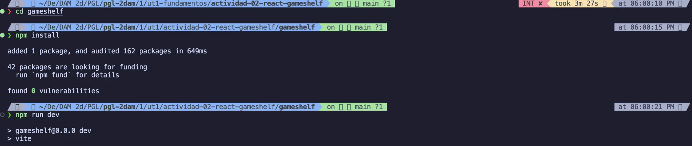
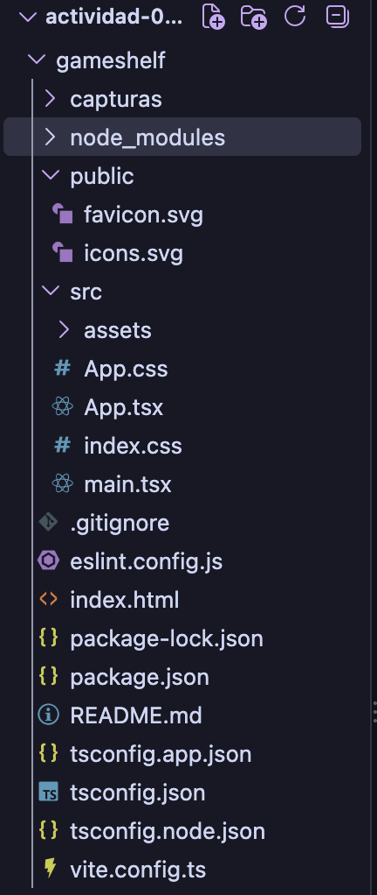
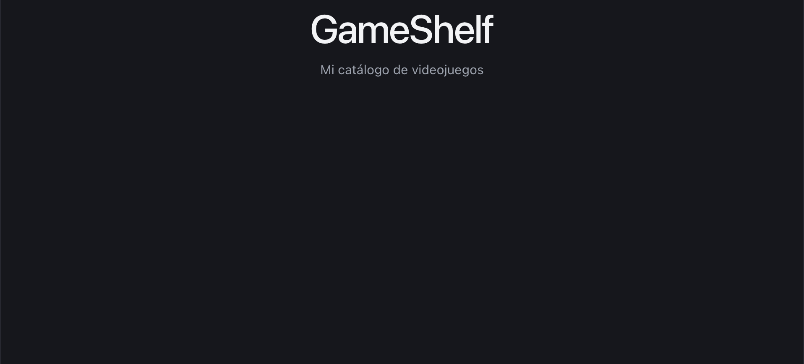

# Actividad 02. GameShelf con React y TypeScript

- **Proyecto:** GameShelf, catálogo de videojuegos
- **Autor:** Diego Gil
- **Curso:** 2.º DAM · Programación multimedia y dispositivos móviles · 2026/2027
- **Tecnologías:** React, TypeScript, Vite, Node.js y npm, Git y GitHub, Visual Studio Code.
- **Repositorio:** https://github.com/diegoalegil/pgl-2dam/tree/main/1er-trimestre/ut1-fundamentos/actividad-02-react-gameshelf/gameshelf

GameShelf es mi primera aplicación con React: una página con un catálogo de videojuegos en tarjetas, con botones para ver solo los disponibles y los que cuestan menos de 15 €.

## Cómo ejecutarla

1. Clona el repositorio: `git clone https://github.com/diegoalegil/pgl-2dam.git`
2. Entra en la carpeta del proyecto: `cd pgl-2dam/1er-trimestre/ut1-fundamentos/actividad-02-react-gameshelf/gameshelf`
3. Instala las dependencias: `npm install`
4. Arranca el servidor: `npm run dev`
5. Abre en el navegador la dirección que aparece, normalmente `http://localhost:5173/`. Para pararlo, pulsa Ctrl + C en la terminal.

## 1. Preparación del proyecto

### Node.js y npm

Primero comprobé que tenía instalados Node.js y npm con `node --version` y `npm --version`. Tengo Node v22.22.2 y npm 10.9.7.

### Crear el proyecto con Vite

Desde la carpeta de la actividad creé el proyecto con:

```bash
npm create vite@latest gameshelf -- --template react-ts
```

Después entré en la carpeta, instalé las dependencias y arranqué el servidor:

```bash
cd gameshelf
npm install
npm run dev
```



### Qué es cada herramienta

**¿Qué es React? ¿Es un lenguaje, una biblioteca o una herramienta para crear proyectos?**
React es una biblioteca de JavaScript para construir interfaces en base a componentes. No es un lenguaje de programación, porque realmente seguimos escribiendo en JavaScript y TypeScript.
Fuente: [Aprender React](https://react.dev/learn)

**¿Qué diferencia hay entre create-vite y Vite? ¿Qué hace Vite con `npm run dev`? ¿Qué hará `npm run build`?**
create-vite es el generador: crea la estructura del proyecto una sola vez. Vite es la herramienta que usamos todo el rato: con `npm run dev` monta un servidor local, traduce el TSX a JavaScript que entiende el navegador y recarga la página cuando guardo (HMR). `npm run build` prepara la versión final optimizada en una carpeta `dist` para publicarla.
Fuente: [Guía de inicio de Vite](https://vite.dev/guide/)

**¿Qué son Node.js y npm? ¿Para qué usamos `npm create`, `npm install` y `npm run dev`?**
Node.js nos permite ejecutar JavaScript fuera del navegador, en el ordenador, como pasa en Java con la JVM. npm es un gestor de paquetes, similar a Maven en Java, que nos descarga las librerías. `npm create` crea el proyecto, luego `npm install` descarga las dependencias y `npm run dev` nos arranca el servidor.
Fuente: [Introducción a npm](https://nodejs.org/en/learn/getting-started/an-introduction-to-the-npm-package-manager)

**¿Qué son las dependencias? ¿Por qué aparece `node_modules`?**
Las dependencias son el código de otras personas que nuestro proyecto necesita, como `react` o `vite`. Están apuntadas en `package.json` y al hacer `npm install` se descargan en la carpeta `node_modules`, que no se sube a GitHub porque pesa mucho y se puede volver a generar.
Fuente: [Dependencias en package.json](https://docs.npmjs.com/specifying-dependencies-and-devdependencies-in-a-package-json-file)

**¿Qué añade TypeScript a JavaScript?**
Tipos. Nos avisa de errores antes de ejecutar, como el compilador de Java.
Fuente: [TypeScript desde cero](https://www.typescriptlang.org/docs/handbook/typescript-from-scratch.html)

**¿Qué significan JSX y TSX?**
JSX es escribir etiquetas como en HTML dentro del propio JavaScript. TSX es lo mismo, pero en archivos TypeScript.
Fuente: [Escribir marcado con JSX](https://react.dev/learn/writing-markup-with-jsx)

**Commit del proyecto creado:** [`796f6a8`](https://github.com/diegoalegil/pgl-2dam/commit/796f6a813da6dfa42536369688c1a0a22f9aec2c)

## 2. Los archivos del proyecto

Esta es la estructura que crea Vite, vista en VS Code:



| Archivo/carpeta | Pregunta para investigar | Función (con mis palabras) |
|---|---|---|
| `index.html` | ¿Qué elemento tiene `id="root"`? | Un `<div>` vacío. Es la caja donde React pinta toda la aplicación, y además carga `main.tsx`. |
| `src/main.tsx` | ¿Qué componente importa? ¿Dónde aparece `createRoot`? | Importa `App` y con `createRoot(...)` lo pinta dentro de `#root`. Es el punto de entrada de React. |
| `src/App.tsx` | ¿Qué interfaz se muestra? | La pantalla de ejemplo de Vite con "Get started" y el botón "Count is 0". Es el componente principal. |
| `src/App.css` | ¿Qué reglas visuales aparecen? | Estilos solo de la pantalla de `App`, como `.counter`, `.hero` o `#center`. |
| `src/index.css` | ¿En qué se diferencia de `App.css`? | Son los estilos generales de toda la página (`body`, `h1`, `p`, los colores en `:root` y el modo oscuro), no solo los de `App`. |
| `package.json` | ¿Qué comandos aparecen en `scripts`? | `dev`, `build`, `lint` y `preview`. También tiene la lista de dependencias. |
| `tsconfig.json` | ¿Qué indica "ts"? ¿Necesitas editarlo hoy? | "ts" es TypeScript: es su configuración. Hoy no hace falta tocarlo. |
| `vite.config.ts` | ¿Qué nombre de herramienta aparece? | Vite, con el plugin de React. Es la configuración de Vite. |
| `public/` y `src/assets/` | ¿Qué recursos encuentras? | En `public/` están `favicon.svg` (el icono de la pestaña) e `icons.svg`. En `src/assets/` están `hero.png`, `react.svg` y `vite.svg`. |
| `node_modules/` | ¿Qué contiene? ¿Por qué no se sube? | Las dependencias descargadas. No se sube porque pesa mucho y se puede volver a generar con `npm install`. |
| `.gitignore` | ¿Qué archivos o carpetas ignora Git? | `node_modules`, `dist`, los archivos `.log` y algunos archivos de editores. |

**¿Qué archivo contiene el punto de entrada HTML?** El `index.html`.

**¿Qué archivo carga App?** El `main.tsx`.

**¿Cuál es el componente principal?** `App`, el de `App.tsx`. Es como el nuevo index, donde va todo lo que se ve.

**¿Qué hace el script dev?** Ejecuta `vite`, que arranca el servidor local y actualiza la página al guardar.

**¿Qué significa la extensión .tsx?** Es un archivo TypeScript donde podemos escribir etiquetas tipo HTML.

En resumen, el orden en el que arranca la aplicación es `index.html` → `main.tsx` → `App.tsx` → navegador.

## 3. Pantalla inicial y componente GameCard

### Pantalla inicial

Borré el ejemplo de Vite de `App.tsx` y puse mi propia pantalla, con un `<main className="app">` que tiene el título y un párrafo. Ahora la página muestra el título "GameShelf" y debajo "Mi catálogo de videojuegos".



**¿Qué es un componente?** Una parte reutilizable de la interfaz. `App` es el componente principal y `GameCard` es otro que puedo usar todas las veces que quiera, como si fuera una etiqueta.

### El componente GameCard

Creé la carpeta `src/components` y dentro `GameCard.tsx`, que es la tarjeta de cada videojuego:

```tsx
type GameCardProps = {
  title: string;
  genre: string;
  price: number;
  available: boolean;
};
```

**¿Qué son las props de GameCard?** Son como los parámetros de un método: los datos que recibe `GameCard` (`title`, `genre`, `price` y `available`) para mostrar cada juego. `GameCardProps` dice cómo se llaman y de qué tipo son, así TypeScript avisa si le paso un dato que no es del tipo correcto.

**¿Qué hace `available ? "Disponible" : "No disponible"`?** Es un ternario, un if/else en una línea: en función de si `available` es true o false, muestra una u otra.

Al crear `GameCard` la página sigue mostrando lo mismo que antes, porque todavía no hemos usado `GameCard` en `App`.

**Commits:** [`64af59d`](https://github.com/diegoalegil/pgl-2dam/commit/64af59dc22ff69733b98fae86abeb458cd2c4a6c) (pantalla inicial) y [`4e9a72c`](https://github.com/diegoalegil/pgl-2dam/commit/4e9a72c731eab8097aae8dbcff58df832acb4d64) (GameCard)
