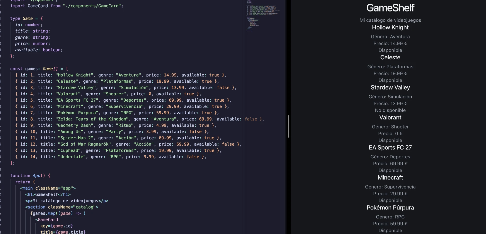
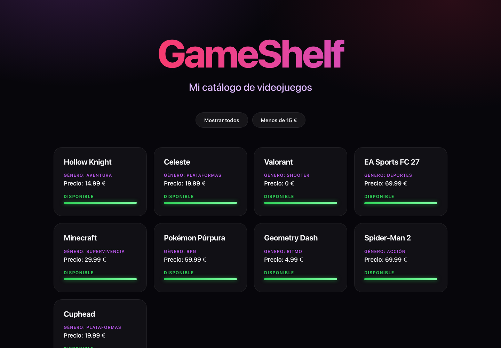
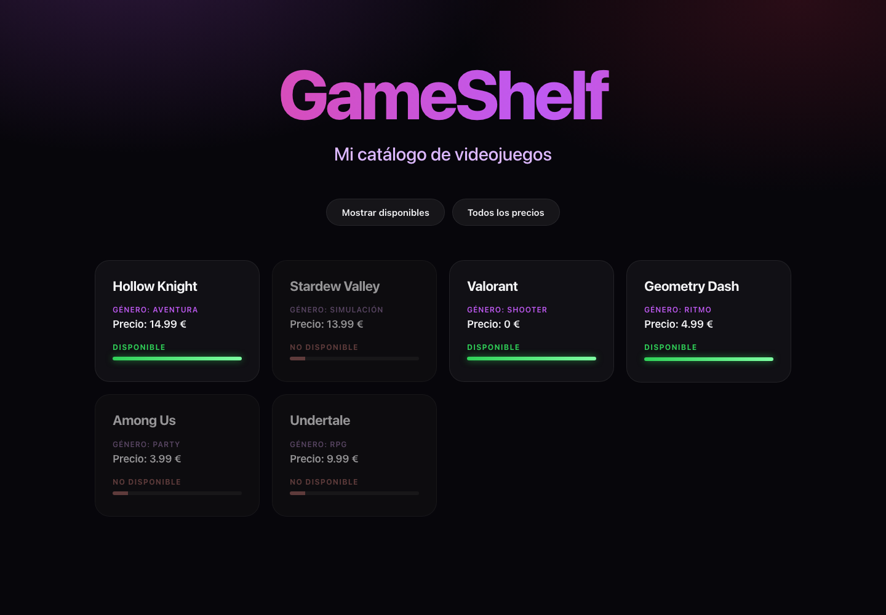
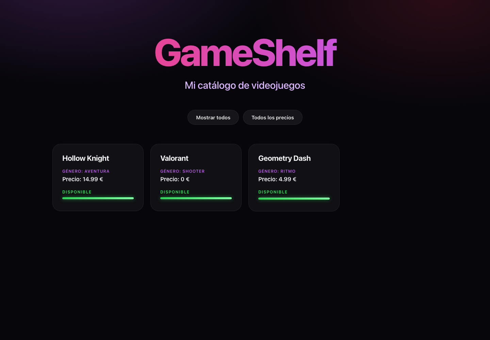

# Actividad 02. GameShelf con React y TypeScript

- **Proyecto:** GameShelf, catálogo de videojuegos
- **Autor:** Diego Gil
- **Curso:** 2.º DAM · Programación multimedia y dispositivos móviles · 2026/2027
- **Tecnologías:** React, TypeScript, Vite, Node.js y npm, Git y GitHub, Visual Studio Code.
- **Repositorio:** https://github.com/diegoalegil/pgl-2dam/tree/main/1er-trimestre/ut1-fundamentos/actividad-02-react-gameshelf/gameshelf

GameShelf es mi primera aplicación con React: una página con un catálogo de videojuegos en tarjetas, con botones para ver solo los disponibles y los que cuestan menos de 15 €.

## Cómo ejecutarla

1. Clona el repositorio: `git clone https://github.com/diegoalegil/pgl-2dam.git`
2. Entra en la carpeta del proyecto: `cd pgl-2dam/1er-trimestre/ut1-fundamentos/actividad-02-react-gameshelf/gameshelf`
3. Instala las dependencias: `npm install`
4. Arranca el servidor: `npm run dev`
5. Abre en el navegador la dirección que aparece, normalmente `http://localhost:5173/`. Para pararlo, pulsa Ctrl + C en la terminal.

## Estructura del proyecto

```text
gameshelf/
├── index.html
├── package.json
├── README.md
├── capturas/              (capturas de este README)
└── src/
    ├── main.tsx           (arranca React y pinta App)
    ├── App.tsx            (los datos, los filtros y el catálogo)
    ├── App.css            (el diseño)
    ├── index.css          (colores y estilos generales)
    └── components/
        └── GameCard.tsx   (la tarjeta de cada juego)
```

## Funcionalidades

- Catálogo de 14 videojuegos en tarjetas, con título, género, precio y disponibilidad.
- Botón "Mostrar disponibles" para ver solo los juegos disponibles.
- Botón "Menos de 15 €" para ver solo los baratos. Los dos filtros se pueden usar a la vez.
- Diseño oscuro en morado y rosa: el título con degradado, las tarjetas se iluminan al pasar el ratón y la disponibilidad sale como una barra de vida.
- Se adapta al móvil.

## 1. Preparación del proyecto

### Node.js y npm

Primero comprobé que tenía instalados Node.js y npm con `node --version` y `npm --version`. Tengo Node v22.22.2 y npm 10.9.7.

### Crear el proyecto con Vite

Desde la carpeta de la actividad creé el proyecto con:

```bash
npm create vite@latest gameshelf -- --template react-ts
```

Después entré en la carpeta, instalé las dependencias y arranqué el servidor:

```bash
cd gameshelf
npm install
npm run dev
```


### Qué es cada herramienta

**¿Qué es React? ¿Es un lenguaje, una biblioteca o una herramienta para crear proyectos?**
React es una biblioteca de JavaScript para construir interfaces en base a componentes. No es un lenguaje de programación, porque realmente seguimos escribiendo en JavaScript y TypeScript.
Fuente: [Aprender React](https://react.dev/learn)

**¿Qué diferencia hay entre create-vite y Vite? ¿Qué hace Vite con `npm run dev`? ¿Qué hará `npm run build`?**
create-vite es el generador: crea la estructura del proyecto una sola vez. Vite es la herramienta que usamos todo el rato: con `npm run dev` monta un servidor local, traduce el TSX a JavaScript que entiende el navegador y recarga la página cuando guardo (HMR). `npm run build` prepara la versión final optimizada en una carpeta `dist` para publicarla.
Fuente: [Guía de inicio de Vite](https://vite.dev/guide/)

**¿Qué son Node.js y npm? ¿Para qué usamos `npm create`, `npm install` y `npm run dev`?**
Node.js nos permite ejecutar JavaScript fuera del navegador, en el ordenador, como pasa en Java con la JVM. npm es un gestor de paquetes, similar a Maven en Java, que nos descarga las librerías. `npm create` crea el proyecto, luego `npm install` descarga las dependencias y `npm run dev` nos arranca el servidor.
Fuente: [Introducción a npm](https://nodejs.org/en/learn/getting-started/an-introduction-to-the-npm-package-manager)

**¿Qué son las dependencias? ¿Por qué aparece `node_modules`?**
Las dependencias son el código de otras personas que nuestro proyecto necesita, como `react` o `vite`. Están apuntadas en `package.json` y al hacer `npm install` se descargan en la carpeta `node_modules`, que no se sube a GitHub porque pesa mucho y se puede volver a generar.
Fuente: [Dependencias en package.json](https://docs.npmjs.com/specifying-dependencies-and-devdependencies-in-a-package-json-file)

**¿Qué añade TypeScript a JavaScript?**
Tipos. Nos avisa de errores antes de ejecutar, como el compilador de Java.
Fuente: [TypeScript desde cero](https://www.typescriptlang.org/docs/handbook/typescript-from-scratch.html)

**¿Qué significan JSX y TSX?**
JSX es escribir etiquetas como en HTML dentro del propio JavaScript. TSX es lo mismo, pero en archivos TypeScript.
Fuente: [Escribir marcado con JSX](https://react.dev/learn/writing-markup-with-jsx)

**Commit del proyecto creado:** [`796f6a8`](https://github.com/diegoalegil/pgl-2dam/commit/796f6a813da6dfa42536369688c1a0a22f9aec2c)

## 2. Los archivos del proyecto

Esta es la estructura que crea Vite, vista en VS Code:


| Archivo/carpeta | Pregunta para investigar | Función (con mis palabras) |
|---|---|---|
| `index.html` | ¿Qué elemento tiene `id="root"`? | Un `<div>` vacío. Es la caja donde React pinta toda la aplicación, y además carga `main.tsx`. |
| `src/main.tsx` | ¿Qué componente importa? ¿Dónde aparece `createRoot`? | Importa `App` y con `createRoot(...)` lo pinta dentro de `#root`. Es el punto de entrada de React. |
| `src/App.tsx` | ¿Qué interfaz se muestra? | La pantalla de ejemplo de Vite con "Get started" y el botón "Count is 0". Es el componente principal. |
| `src/App.css` | ¿Qué reglas visuales aparecen? | Estilos solo de la pantalla de `App`, como `.counter`, `.hero` o `#center`. |
| `src/index.css` | ¿En qué se diferencia de `App.css`? | Son los estilos generales de toda la página (`body`, `h1`, `p`, los colores en `:root` y el modo oscuro), no solo los de `App`. |
| `package.json` | ¿Qué comandos aparecen en `scripts`? | `dev`, `build`, `lint` y `preview`. También tiene la lista de dependencias. |
| `tsconfig.json` | ¿Qué indica "ts"? ¿Necesitas editarlo hoy? | "ts" es TypeScript: es su configuración. Hoy no hace falta tocarlo. |
| `vite.config.ts` | ¿Qué nombre de herramienta aparece? | Vite, con el plugin de React. Es la configuración de Vite. |
| `public/` y `src/assets/` | ¿Qué recursos encuentras? | En `public/` están `favicon.svg` (el icono de la pestaña) e `icons.svg`. En `src/assets/` están `hero.png`, `react.svg` y `vite.svg`. |
| `node_modules/` | ¿Qué contiene? ¿Por qué no se sube? | Las dependencias descargadas. No se sube porque pesa mucho y se puede volver a generar con `npm install`. |
| `.gitignore` | ¿Qué archivos o carpetas ignora Git? | `node_modules`, `dist`, los archivos `.log` y algunos archivos de editores. |

**¿Qué archivo contiene el punto de entrada HTML?** El `index.html`.

**¿Qué archivo carga App?** El `main.tsx`.

**¿Cuál es el componente principal?** `App`, el de `App.tsx`. Es como el nuevo index, donde va todo lo que se ve.

**¿Qué hace el script dev?** Ejecuta `vite`, que arranca el servidor local y actualiza la página al guardar.

**¿Qué significa la extensión .tsx?** Es un archivo TypeScript donde podemos escribir etiquetas tipo HTML.

En resumen, el orden en el que arranca la aplicación es `index.html` → `main.tsx` → `App.tsx` → navegador.

## 3. Pantalla inicial y componente GameCard

### Pantalla inicial

Borré el ejemplo de Vite de `App.tsx` y puse mi propia pantalla, con un `<main className="app">` que tiene el título y un párrafo. Ahora la página muestra el título "GameShelf" y debajo "Mi catálogo de videojuegos".


**¿Qué es un componente?** Una parte reutilizable de la interfaz. `App` es el componente principal y `GameCard` es otro que puedo usar todas las veces que quiera, como si fuera una etiqueta.

### El componente GameCard

Creé la carpeta `src/components` y dentro `GameCard.tsx`, que es la tarjeta de cada videojuego:

```tsx
type GameCardProps = {
  title: string;
  genre: string;
  price: number;
  available: boolean;
};
```

**¿Qué son las props de GameCard?** Son como los parámetros de un método: los datos que recibe `GameCard` (`title`, `genre`, `price` y `available`) para mostrar cada juego. `GameCardProps` dice cómo se llaman y de qué tipo son, así TypeScript avisa si le paso un dato que no es del tipo correcto.

**¿Qué hace `available ? "Disponible" : "No disponible"`?** Es un ternario, un if/else en una línea: en función de si `available` es true o false, muestra una u otra.

Al crear `GameCard` la página sigue mostrando lo mismo que antes, porque todavía no hemos usado `GameCard` en `App`.

**Commits:** [`64af59d`](https://github.com/diegoalegil/pgl-2dam/commit/64af59dc22ff69733b98fae86abeb458cd2c4a6c) (pantalla inicial) y [`4e9a72c`](https://github.com/diegoalegil/pgl-2dam/commit/4e9a72c731eab8097aae8dbcff58df832acb4d64) (GameCard)

## 4. Catálogo con map()

### Los datos

En `App.tsx` creé el tipo `Game`, que dice cómo es cada videojuego, y el array `games`, que es una lista de juegos (`Game[]`):

```tsx
type Game = {
  id: number;
  title: string;
  genre: string;
  price: number;
  available: boolean;
};
```

Primero puse los tres de ejemplo (Hollow Knight, Celeste y Stardew Valley) y comprobé que salían las tres tarjetas.

### Mostrar las tarjetas con map()

```tsx
{games.map((game) => (
  <GameCard
    key={game.id}
    title={game.title}
    genre={game.genre}
    price={game.price}
    available={game.available}
  />
))}
```

**¿Qué hace map()?** Recorre el array `games` y transforma cada juego en un componente `GameCard`. Es lo mismo que hacía en la Pokédex para crear las tarjetas.

**¿Para qué sirve key?** Es un identificador único de cada tarjeta (el `id` del juego). React lo usa para saber qué tarjeta es cada una cuando la lista cambia, por ejemplo al filtrar.

**¿Qué es una función?** Un bloque de instrucciones que se ejecuta cuando la llamo.

**¿Qué diferencia hay entre definirla y llamarla?** Definirla es escribirla (`function saludar() {...}`). Llamarla es ejecutarla, con su nombre y paréntesis (`saludar()`).

**¿Qué recibe `game` en cada vuelta?** Un juego distinto del array: en la primera Hollow Knight, en la segunda Celeste, y así hasta el último.

**¿Qué devuelve la función flecha dentro de map()?** Un `GameCard` con los datos de ese juego.

Fuente: [Mostrar listas en React](https://react.dev/learn/rendering-lists)

### Mis videojuegos

Elegí los juegos porque los he jugado y todos me gustan. Dejé los tres de ejemplo y añadí once más, mezclando disponibles y no disponibles, y baratos y caros, para que se noten los filtros. Los precios son aproximados de las tiendas. En total hay 14:

| Juego | Género | Precio | Disponible |
|---|---|---|---|
| Hollow Knight | Aventura | 14,99 € | Sí |
| Celeste | Plataformas | 19,99 € | Sí |
| Stardew Valley | Simulación | 13,99 € | No |
| Valorant | Shooter | 0 € | Sí |
| EA Sports FC 27 | Deportes | 69,99 € | Sí |
| Minecraft | Supervivencia | 29,99 € | Sí |
| Pokémon Púrpura | RPG | 59,99 € | Sí |
| Zelda: Tears of the Kingdom | Aventura | 69,99 € | No |
| Geometry Dash | Ritmo | 4,99 € | Sí |
| Among Us | Party | 3,99 € | No |
| Spider-Man 2 | Acción | 69,99 € | Sí |
| God of War Ragnarök | Acción | 69,99 € | No |
| Cuphead | Plataformas | 19,99 € | Sí |
| Undertale | RPG | 9,99 € | No |



**Commits:** [`f2386e4`](https://github.com/diegoalegil/pgl-2dam/commit/f2386e4aae5eb08019bad64d76bc587109dcc331) (tres tarjetas con map), [`aa04cd4`](https://github.com/diegoalegil/pgl-2dam/commit/aa04cd4f18f04f094b56793c920e0fdc4055f031) (catálogo ampliado) y [`ae7a5a8`](https://github.com/diegoalegil/pgl-2dam/commit/ae7a5a8fffc578bbc14bf6a4dcdb6a6fc0e6e02e) (cambio de algunos juegos)

## 5. Estilos CSS

**¿Qué es CSS?** El lenguaje para darle estilo a la página: colores, tamaños, espacios, posiciones…

**¿Qué es un selector?** La parte de la regla que dice a qué elementos se aplica. Por ejemplo, `.card` se aplica a todo lo que tiene `className="card"`, y `.card h2` solo al título de dentro de cada tarjeta.

**¿Qué es una propiedad CSS?** Lo que cambias del elemento, con su valor. Por ejemplo, `color: var(--morado)` o `border-radius: 24px` (las esquinas redondeadas).

**¿Dónde escribí los estilos?** En `index.css` puse lo general de toda la página: el fondo, la fuente y los colores guardados en variables como `--morado` o `--rosa`. En `App.css` puse el diseño: el título, la cuadrícula y las tarjetas.

**¿Cómo conecté className con el CSS?** En el TSX pongo `className="card"` y en el CSS la regla `.card { ... }`, con un punto delante, que quiere decir "clase". En JSX se escribe `className` porque `class` es una palabra reservada de JavaScript (las clases, como `class Pokemon`). Para "Disponible" uso un ternario que elige la clase: `available` (verde) o `unavailable` (rojo).

**Lo que más me gusta del diseño:**

- el título con degradado morado y rosa (`linear-gradient` + `background-clip: text`),
- las tarjetas que suben y se iluminan como un neón al pasar el ratón (`:hover` + `transform` + `box-shadow`),
- la disponibilidad como una barra de vida de videojuego (`::after`, un elemento "falso" que creo desde el CSS),
- que los juegos no disponibles salgan apagados, como bloqueados (`:has()` + `filter: grayscale`).

**Commits:** [`b565244`](https://github.com/diegoalegil/pgl-2dam/commit/b565244) (diseño) y [`c752b1b`](https://github.com/diegoalegil/pgl-2dam/commit/c752b1b) (barra de vida y contorno iluminado)

## 6. Filtro de disponibles

Una variable normal puede cambiar, pero React no vuelve a pintar la pantalla por ese cambio. Por eso uso estado con `useState`:

```tsx
const [onlyAvailable, setOnlyAvailable] = useState(false);

const visibleGames = onlyAvailable
  ? games.filter((game) => game.available)
  : games;
```

```tsx
<button onClick={() => setOnlyAvailable(!onlyAvailable)}>
  {onlyAvailable ? "Mostrar todos" : "Mostrar disponibles"}
</button>
```

- `useState(false)` crea el estado. Empieza en `false`, así que al principio se ven todos.
- `onlyAvailable` es el valor actual y `setOnlyAvailable` la función para cambiarlo.
- `filter()` crea una lista nueva solo con los juegos que cumplen la condición, en este caso `game.available`. No cambia el array original.
- El ternario elige: si el filtro está activo usa la lista filtrada, y si no, `games` entero.
- El `!` invierte el valor: `false` pasa a `true` y `true` a `false`. Por eso el mismo botón activa y desactiva el filtro.

**Pasar una función o llamarla:** en `onClick` tengo que pasar una función para que React la ejecute cuando haga clic. Si pusiera `onClick={setOnlyAvailable(!onlyAvailable)}`, se ejecutaría nada más pintar la página. Por eso va dentro de una función flecha: `() => setOnlyAvailable(!onlyAvailable)`. Los paréntesis vacíos son que no recibe parámetros, la flecha separa los parámetros del código, y lo de la derecha es lo que se ejecuta al hacer clic.

**¿Qué diferencia hay entre estado y variable normal?** Si cambio una variable normal, la pantalla no se entera y sigue igual. Si cambio el estado con su `set`, React vuelve a pintar el componente con el valor nuevo.

**¿Qué hace onClick?** Escucha el clic en el botón y ejecuta la función que le paso.

Con el filtro activo se ven 9 juegos de los 14:



Fuente: [Estado de un componente](https://react.dev/learn/state-a-components-memory)

## 7. Reto: juegos por menos de 15 €

Añadí un segundo estado y un segundo botón. Lo importante es que el filtro de precio se aplica **sobre la lista que ya salió del filtro de disponibles** (`visibleGames`), no sobre `games`. Si empezara otra vez desde `games`, los filtros no se combinarían.

```tsx
const [onlyUnder15, setOnlyUnder15] = useState(false);

const filteredGames = onlyUnder15
  ? visibleGames.filter((game) => game.price < 15)
  : visibleGames;
```

`game.price < 15` significa que el precio sea menor que 15. El `map()` ahora recorre `filteredGames`, que es la lista con los dos filtros aplicados.

`useState` devuelve el valor actual y una función para actualizarlo, y cuando lo actualizo React vuelve a pintar el componente. Por eso al pulsar un botón cambian las tarjetas y también el texto del botón.

### Pruebas

Primero lo probé con los tres juegos de ejemplo y daba lo mismo que la tabla del enunciado. Después, con mis 14 juegos:

| Filtros activados | Resultado |
|---|---|
| Ninguno | Los 14 juegos |
| Disponibles | 9: Hollow Knight, Celeste, Valorant, EA Sports FC 27, Minecraft, Pokémon Púrpura, Geometry Dash, Spider-Man 2 y Cuphead |
| Menos de 15 € | 6: Hollow Knight, Stardew Valley, Valorant, Geometry Dash, Among Us y Undertale |
| Disponibles y menos de 15 € | 3: Hollow Knight, Valorant y Geometry Dash |

Solo el filtro de precio:



Los dos filtros a la vez:



**Commit de los filtros:** [`35645bf`](https://github.com/diegoalegil/pgl-2dam/commit/35645bfe0a041f9a07168411e49355bcc95b8949)

## 8. Glosario

| Concepto | Con mis palabras | Fuente |
|---|---|---|
| JavaScript | El lenguaje de programación de la web. | [MDN](https://developer.mozilla.org/es/docs/Web/JavaScript) |
| TypeScript | JavaScript con tipos. Avisa de errores antes de ejecutar, como el compilador de Java. | [TypeScript](https://www.typescriptlang.org/docs/handbook/typescript-from-scratch.html) |
| JSX | Escribir etiquetas como en HTML dentro del propio JavaScript. | [React](https://react.dev/learn/writing-markup-with-jsx) |
| TSX | Lo mismo que JSX, pero en archivos TypeScript. | [React](https://react.dev/learn/typescript) |
| Componente | Una parte reutilizable de la interfaz, como `GameCard`. | [React](https://react.dev/learn/your-first-component) |
| Props | Los datos que un componente recibe de otro, como los parámetros de un método. | [React](https://react.dev/learn/passing-props-to-a-component) |
| Función | Un bloque de instrucciones que se ejecuta cuando la llamo. | [MDN](https://developer.mozilla.org/es/docs/Web/JavaScript/Guide/Functions) |
| Parámetro | El nombre que recibe un valor dentro de una función, como `game` dentro del `map`. | [MDN](https://developer.mozilla.org/es/docs/Glossary/Parameter) |
| Función flecha | Otra forma de escribir una función: `(game) => game.available`. | [MDN](https://developer.mozilla.org/es/docs/Web/JavaScript/Reference/Functions/Arrow_functions) |
| Evento | Algo que pasa en la página, como un clic. | [React](https://react.dev/learn/responding-to-events) |
| Manejador | La función que responde a un evento, la que va en `onClick`. | [React](https://react.dev/learn/responding-to-events) |
| Estado | Un dato que React guarda y que, al cambiar, hace que se vuelva a pintar la pantalla. | [React](https://react.dev/learn/state-a-components-memory) |
| Callback | Una función que le paso a otra para que la ejecute ella, como la flecha que le paso a `map` o a `filter`. | [MDN](https://developer.mozilla.org/es/docs/Glossary/Callback_function) |
| map() | Recorre un array y transforma cada elemento en otra cosa. | [MDN](https://developer.mozilla.org/es/docs/Web/JavaScript/Reference/Global_Objects/Array/map) |
| filter() | Crea una lista nueva solo con los elementos que cumplen una condición. | [MDN](https://developer.mozilla.org/es/docs/Web/JavaScript/Reference/Global_Objects/Array/filter) |
| key | El identificador único de cada elemento de una lista, para que React los distinga. | [React](https://react.dev/learn/rendering-lists) |

## 9. Reflexión y conclusiones

**1. ¿Qué archivo conecta el HTML con App?** El `main.tsx`. Busca el `<div id="root">` del `index.html` y pinta `App` dentro.

**2. ¿Qué diferencias hay entre React, TypeScript y Vite?** React es la biblioteca con la que hago los componentes. TypeScript es el lenguaje, JavaScript con tipos. Vite es la herramienta que crea el servidor y prepara el proyecto.

**3. ¿Qué son las props de GameCard?** Los datos que recibe cada tarjeta: `title`, `genre`, `price` y `available`. Son como los parámetros de un método.

**4. ¿Por qué usamos setOnlyAvailable para cambiar el estado?** Porque si cambio el valor a mano, React no se entera. Con `setOnlyAvailable` React sabe que ha cambiado y vuelve a pintar las tarjetas.

**5. ¿Qué hacen map() y filter()?** `map()` transforma cada juego en una tarjeta y `filter()` se queda solo con los juegos que cumplen la condición.

**6. ¿Para qué sirve key?** Para que React sepa qué tarjeta es cada una cuando la lista cambia al filtrar.

**7. ¿Qué error te costó más resolver y cómo lo solucionaste?** Escribí `avliable` en vez de `available` en `GameCard`. Como lo puse igual en todos los sitios, no daba error, pero al pasarle `available` desde `App` no habría coincidido. Lo vi al revisar el código antes de seguir. También me costó al principio entender `map()`, porque pensaba que era una lista ordenada y en realidad transforma cada elemento.

### Dificultades

- Los errores de sintaxis en JSX, como poner `return{` en vez de `return (` o no cerrar unas comillas.
- Entender la diferencia entre pasar una función a `onClick` y llamarla.
- Que el segundo filtro tenía que empezar desde la lista del primero para que se combinaran.

### Lo que he aprendido

Se parece mucho a la Pokédex, pero React hace por mí lo de volver a pintar las tarjetas. En la Pokédex tenía que llamar a `mostrarTarjetas()` cada vez que cambiaba algo, y aquí solo cambio el estado y React se encarga. Los componentes también ahorran mucho, porque escribo `GameCard` una vez y sale 14 veces.

### Mejoras para el futuro

- Un buscador por nombre, como el de la Pokédex.
- Un filtro por género.
- Poner la imagen de cada juego en su tarjeta.
- Un contador con los juegos que se están mostrando, usando `length`.

## Fuentes

- [Guía de inicio de Vite](https://vite.dev/guide/)
- [Aprender React](https://react.dev/learn)
- [Primer componente de React](https://react.dev/learn/your-first-component)
- [Estado de un componente](https://react.dev/learn/state-a-components-memory)
- [Mostrar listas en React](https://react.dev/learn/rendering-lists)
- [MDN: Array.map y Array.filter](https://developer.mozilla.org/es/docs/Web/JavaScript/Reference/Global_Objects/Array)
