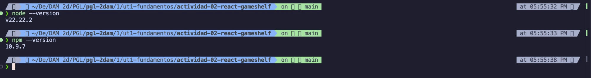
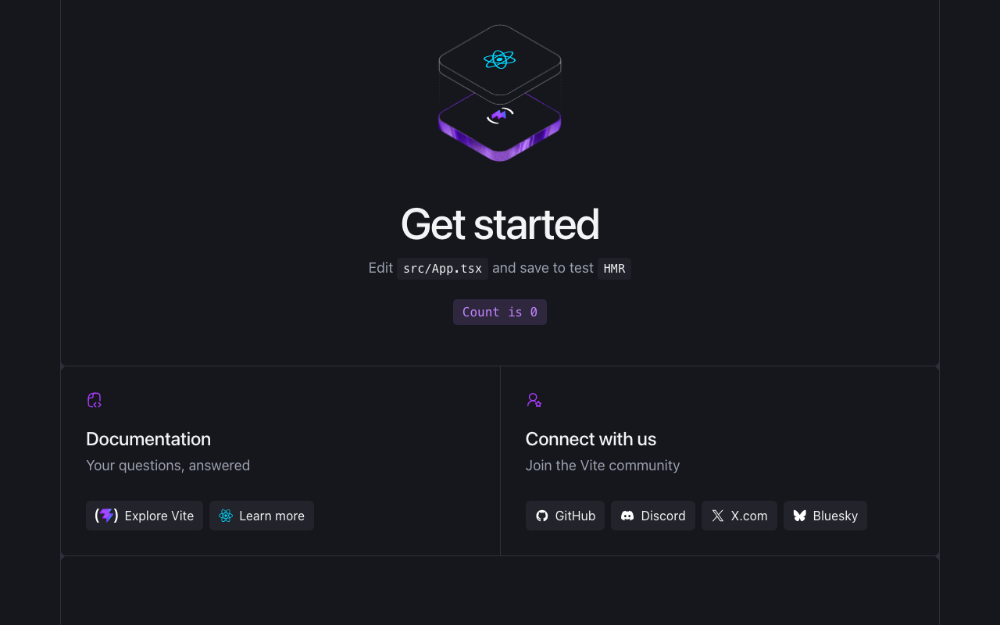

# Actividad 02. GameShelf con React y TypeScript

- **Proyecto:** GameShelf, catálogo de videojuegos
- **Autor:** Diego Gil
- **Curso:** 2.º DAM · Programación multimedia y dispositivos móviles · 2026/2027
- **Tecnologías:** React, TypeScript, Vite, Node.js y npm, Git y GitHub, Visual Studio Code.
- **Repositorio:** https://github.com/diegoalegil/pgl-2dam/tree/main/1er-trimestre/ut1-fundamentos/actividad-02-react-gameshelf/gameshelf

GameShelf es mi primera aplicación con React: una página con un catálogo de videojuegos en tarjetas, con botones para ver solo los disponibles y los que cuestan menos de 15 €.

## Cómo ejecutarla

1. Clona el repositorio: `git clone https://github.com/diegoalegil/pgl-2dam.git`
2. Entra en la carpeta del proyecto: `cd pgl-2dam/1er-trimestre/ut1-fundamentos/actividad-02-react-gameshelf/gameshelf`
3. Instala las dependencias: `npm install`
4. Arranca el servidor: `npm run dev`
5. Abre en el navegador la dirección que aparece, normalmente `http://localhost:5173/`. Para pararlo, pulsa Ctrl + C en la terminal.

## 1. Preparación del proyecto

### Node.js y npm

Primero comprobé que tenía instalados Node.js y npm con `node --version` y `npm --version`. Tengo Node v22.22.2 y npm 10.9.7.



### Crear el proyecto con Vite

Desde la carpeta de la actividad creé el proyecto con:

```bash
npm create vite@latest gameshelf -- --template react-ts
```

Después entré en la carpeta, instalé las dependencias y arranqué el servidor:

```bash
cd gameshelf
npm install
npm run dev
```


Esta es la pantalla de ejemplo que trae Vite en `http://localhost:5173/`:



### Qué es cada herramienta

**¿Qué es React? ¿Es un lenguaje, una biblioteca o una herramienta para crear proyectos?**
React es una biblioteca de JavaScript para construir interfaces en base a componentes. No es un lenguaje de programación, porque realmente seguimos escribiendo en JavaScript y TypeScript.
Fuente: [Aprender React](https://react.dev/learn)

**¿Qué diferencia hay entre create-vite y Vite? ¿Qué hace Vite con `npm run dev`? ¿Qué hará `npm run build`?**
create-vite es el generador: crea la estructura del proyecto una sola vez. Vite es la herramienta que usamos todo el rato: con `npm run dev` monta un servidor local, traduce el TSX a JavaScript que entiende el navegador y recarga la página cuando guardo (HMR). `npm run build` prepara la versión final optimizada en una carpeta `dist` para publicarla.
Fuente: [Guía de inicio de Vite](https://vite.dev/guide/)

**¿Qué son Node.js y npm? ¿Para qué usamos `npm create`, `npm install` y `npm run dev`?**
Node.js nos permite ejecutar JavaScript fuera del navegador, en el ordenador, como pasa en Java con la JVM. npm es un gestor de paquetes, similar a Maven en Java, que nos descarga las librerías. `npm create` crea el proyecto, luego `npm install` descarga las dependencias y `npm run dev` nos arranca el servidor.
Fuente: [Introducción a npm](https://nodejs.org/en/learn/getting-started/an-introduction-to-the-npm-package-manager)

**¿Qué son las dependencias? ¿Por qué aparece `node_modules`?**
Las dependencias son el código de otras personas que nuestro proyecto necesita, como `react` o `vite`. Están apuntadas en `package.json` y al hacer `npm install` se descargan en la carpeta `node_modules`, que no se sube a GitHub porque pesa mucho y se puede volver a generar.
Fuente: [Dependencias en package.json](https://docs.npmjs.com/specifying-dependencies-and-devdependencies-in-a-package-json-file)

**¿Qué añade TypeScript a JavaScript?**
Tipos. Nos avisa de errores antes de ejecutar, como el compilador de Java.
Fuente: [TypeScript desde cero](https://www.typescriptlang.org/docs/handbook/typescript-from-scratch.html)

**¿Qué significan JSX y TSX?**
JSX es escribir etiquetas como en HTML dentro del propio JavaScript. TSX es lo mismo, pero en archivos TypeScript.
Fuente: [Escribir marcado con JSX](https://react.dev/learn/writing-markup-with-jsx)

**Commit del proyecto creado:** [`796f6a8`](https://github.com/diegoalegil/pgl-2dam/commit/796f6a813da6dfa42536369688c1a0a22f9aec2c)
