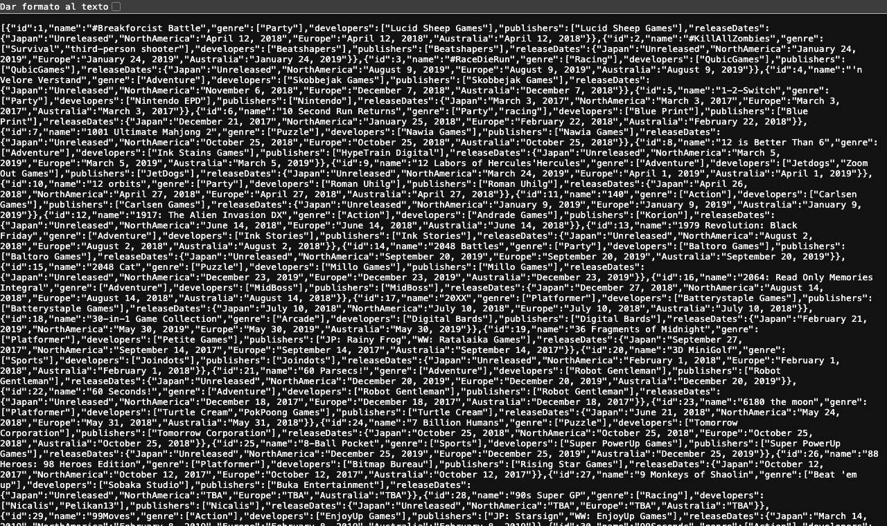
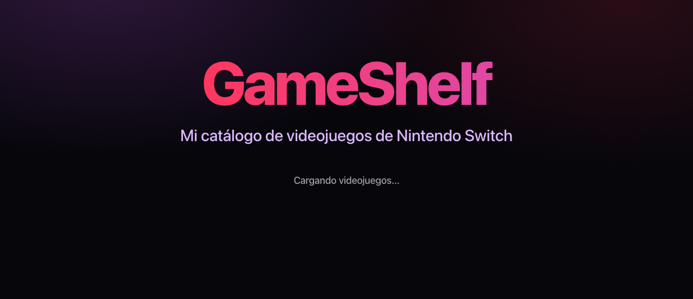
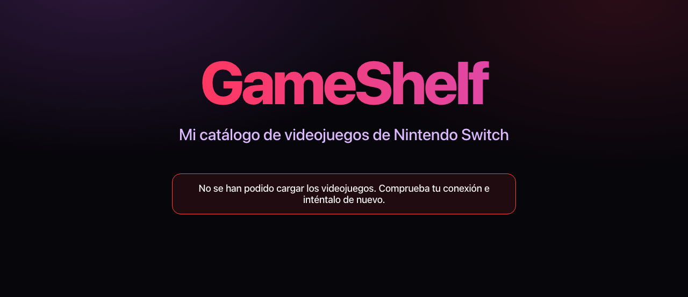
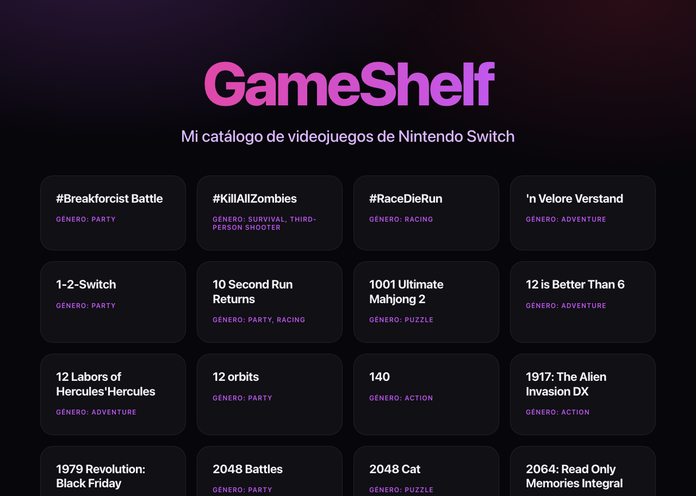

# Actividad 03. GameShelf con React y Axios

- **Proyecto:** GameShelf conectada a una API de videojuegos
- **Autor:** Diego Gil
- **Curso:** 2.º DAM · Programación multimedia y dispositivos móviles · 2026/2027
- **Tecnologías:** React, TypeScript, Vite, Axios, Node.js y npm, Git y GitHub, Visual Studio Code.
- **Repositorio:** https://github.com/diegoalegil/pgl-2dam/tree/main/1er-trimestre/ut1-fundamentos/actividad-03-react-axios/gameshelf

En esta actividad conecto GameShelf con una API de videojuegos de Nintendo Switch. Los juegos ya no están escritos a mano en el código: la app se los pide a la API con Axios y los muestra en tarjetas.

## Cómo ejecutarla

1. Clona el repositorio: `git clone https://github.com/diegoalegil/pgl-2dam.git`
2. Entra en la carpeta del proyecto: `cd pgl-2dam/1er-trimestre/ut1-fundamentos/actividad-03-react-axios/gameshelf`
3. Instala las dependencias: `npm install`
4. Arranca el servidor: `npm run dev`
5. Abre en el navegador la dirección que aparece, normalmente `http://localhost:5173/`. Para pararlo, pulsa Ctrl + C en la terminal.

Necesita conexión a internet, porque los juegos vienen de la API.

## Estructura del proyecto

```text
gameshelf/
├── index.html
├── package.json           (aquí aparece axios en las dependencias)
├── README.md
├── capturas/              (capturas de este README)
└── src/
    ├── main.tsx           (arranca React y pinta App)
    ├── App.tsx            (la petición a la API, la carga, el error y la lista)
    ├── App.css            (el diseño)
    ├── index.css          (colores y estilos generales)
    ├── types/
    │   └── Juego.ts       (el tipo de los juegos que vienen de la API)
    └── components/
        └── GameCard.tsx   (la tarjeta de cada juego)
```

## Funcionalidades

- Pide los videojuegos a la API de SampleAPIs con Axios al abrir la página.
- Muestra los 20 primeros en tarjetas, con su nombre y su género.
- Mientras llegan los datos sale "Cargando videojuegos...".
- Si la petición falla, sale un mensaje de error que se entiende.
- Mantiene el diseño de la actividad anterior: oscuro en morado y rosa, y las tarjetas se iluminan al pasar el ratón.

## 1. Preparación del proyecto

La actividad dice que trabaje sobre el GameShelf de la Actividad 02, pero esa ya la entregué y no quería cambiarla. Así que copié el proyecto a una carpeta nueva, `actividad-03-react-axios`, sin `node_modules` (eso se vuelve a descargar), y lo arranqué como en la actividad anterior:

```bash
cd actividad-03-react-axios/gameshelf
npm install
npm run dev
```

Al abrir `http://localhost:5173/` sale el GameShelf de antes, con los 14 juegos y los dos filtros. A partir de aquí lo voy cambiando para que los juegos vengan de la API.

## 2. La API de SampleAPIs

La API es el catálogo de juegos de Nintendo Switch de SampleAPIs: https://api.sampleapis.com/switch/games

Al abrirla en el navegador sale mucho texto seguido, pero empieza por `[`, así que **la respuesta es una lista** (un array), no un objeto suelto. Cada elemento de la lista es un objeto `{ }` con un juego. En total hay 1043 juegos.



Si pido un solo juego, por ejemplo `https://api.sampleapis.com/switch/games/1`, ahí sí devuelve un objeto solo.

Así es el primer juego, ordenado para que se lea mejor:

```json
{
  "id": 1,
  "name": "#Breakforcist Battle",
  "genre": ["Party"],
  "developers": ["Lucid Sheep Games"],
  "publishers": ["Lucid Sheep Games"],
  "releaseDates": {
    "Japan": "Unreleased",
    "NorthAmerica": "April 12, 2018",
    "Europe": "April 12, 2018",
    "Australia": "April 12, 2018"
  }
}
```

Miré varios juegos y estos son los campos que pide la actividad:

| Campo | Tipo | ¿Sale siempre? | Lo que vi |
|---|---|---|---|
| `id` | número | Sí | Es distinto en cada juego, va del 1 al 1043 |
| `name` | texto | Sí | El nombre del juego |
| `genre` | **lista de textos** | Sí | Aunque sea un solo género viene entre `[ ]`. Hay juegos con 2, 3 y hasta 4 géneros |
| `releaseDates` | objeto | Sí | Tiene las fechas de `Japan`, `NorthAmerica`, `Europe` y `Australia`. Son textos, no fechas: a veces pone "Unreleased" o "TBA" |

Además vienen `developers` y `publishers`, que también son listas de textos. Lo comprobé en los 1043 juegos y todos los campos salen siempre.

Lo más importante para el código es que `genre` es una lista y no un texto, así que no lo puedo pintar directamente.

## 3. Axios y npm

### Qué es Axios

Axios es una librería de JavaScript para hacer peticiones a servidores (pedir datos a una API, enviarlos...). Funciona con promesas y sirve tanto en el navegador como en Node. Hace lo mismo que `fetch`, que ya usé en la Pokédex, pero con dos ventajas:

- Convierte el JSON él solo y me deja los datos en `respuesta.data`. Con `fetch` tenía que hacer `await respuesta.json()`.
- Si el servidor responde con un error (por ejemplo un 404), Axios lo trata como error y salta al `catch`. Con `fetch` tenía que comprobar yo `respuesta.ok`.

### Instalarlo

Desde la terminal integrada de VS Code, dentro de la carpeta `gameshelf`:

```bash
npm install axios
```

Me salió `added 25 packages`. En `package.json` solo cambió una línea, dentro de `dependencies`:

```diff
   "dependencies": {
+    "axios": "^1.20.0",
     "react": "^19.2.8",
     "react-dom": "^19.2.8"
   },
```

El `^` quiere decir que acepta versiones nuevas de la 1 (1.20.1, 1.21...) pero nunca la 2.0.0, que podría cambiar cosas y romper el código.

También cambió `package-lock.json`, mucho más: se añadieron 25 paquetes, axios y los que necesita él para funcionar (`follow-redirects`, `form-data`, `proxy-from-env`...). Ahí se guarda la versión exacta de cada uno, para que si otro hace `npm install` le salgan las mismas.

### Qué descubrí de npm, las dependencias y node_modules

- **Dependencia:** es código de otras personas que mi proyecto necesita para funcionar, como React o ahora Axios. En `dependencies` va lo que necesita la app cuando se usa, y en `devDependencies` lo que solo hace falta para programar (Vite, TypeScript, ESLint). Axios va en `dependencies` porque su código acaba dentro de la app.
- **npm:** es el gestor de paquetes de Node, parecido a Maven en Java. Descarga las librerías de internet (de npmjs.com) y las apunta en `package.json`. `npm install` sin nada instala todo lo que ya está apuntado, y `npm install axios` añade un paquete nuevo.
- **node_modules:** es la carpeta donde npm descarga el código de todas las dependencias, también las que necesitan ellas. A mí me ocupa 121 MB. No se toca a mano, porque si reinstalas se pierden los cambios, y no se sube a GitHub: ya viene en el `.gitignore` y cualquiera la puede volver a crear con `npm install`. Lo que sí se sube es `package.json` y `package-lock.json`.

**¿Qué hace Axios y qué descubrí sobre esos archivos y herramientas?** Axios hace las peticiones a la API y me da los datos ya preparados. npm lo instala y lo apunta como dependencia en `package.json`, la versión exacta queda guardada en `package-lock.json` y el código descargado está en `node_modules`, que no se sube.

Fuentes: [Axios](https://axios.rest/), [npm install](https://docs.npmjs.com/cli/commands/npm-install), [package.json](https://docs.npmjs.com/cli/configuring-npm/package-json)

## 4. Conectar GameShelf con la API

### El tipo Juego

Como el proyecto es TypeScript, primero hice un tipo para los juegos en un archivo nuevo, `src/types/Juego.ts`. Lo hice a partir del JSON que miré antes, y solo con los campos que uso:

```ts
export interface Juego {
  id: number;
  name: string;
  genre: string[];
}
```

`genre` es `string[]` (una lista de textos) porque en la API viene entre `[ ]`. El tipo `Game` de la actividad anterior (`title`, `price`, `available`) ya no me sirve, porque la API no tiene esos campos.

### Quitar los juegos fijos y pedirlos a la API

En `App.tsx` borré la lista de 14 juegos que tenía escrita a mano y los dos filtros, porque la actividad dice que los datos tienen que venir de la petición y que no añada filtros. En su lugar:

```tsx
const URL_API = "https://api.sampleapis.com/switch/games";

function App() {
  const [juegos, setJuegos] = useState<Juego[]>([]);

  useEffect(() => {
    async function cargarJuegos(): Promise<void> {
      try {
        const respuesta = await axios.get<Juego[]>(URL_API);
        setJuegos(respuesta.data);
      } catch (errorCapturado) {
        console.error(errorCapturado);
      }
    }

    cargarJuegos();
  }, []);
```

- `useState<Juego[]>([])` guarda los juegos. Empieza como una lista vacía porque al principio todavía no han llegado.
- `useEffect(() => { ... }, [])` ejecuta lo de dentro cuando se muestra el componente. El `[]` del final hace que sea **solo una vez**, al principio. Si no lo pongo, se ejecutaría después de cada render y, como dentro cambio el estado, se harían peticiones sin parar.
- La función que le paso a `useEffect` no puede ser `async`, así que creo dentro `cargarJuegos`, que sí lo es, y la llamo justo debajo.
- `axios.get<Juego[]>(URL_API)` hace la petición GET. El `<Juego[]>` le dice a TypeScript que lo que viene es una lista de juegos.
- Con `await` espero la respuesta y los juegos están en `respuesta.data`. Al hacer `setJuegos(respuesta.data)` React vuelve a pintar la página con ellos.

Arriba del archivo están los imports:

```tsx
import { useEffect, useState } from "react";
import axios from "axios";
import type { Juego } from "./types/Juego";
```

Axios se importa sin llaves porque es la exportación por defecto, y sin ruta porque viene de `node_modules`. El tipo va con `import type` porque el proyecto lo exige (si no, da error).

### La tarjeta con los datos de la API

`GameCard` ahora recibe el juego entero en vez de cada dato por separado, y muestra el nombre y el género:

```tsx
export default function GameCard({ juego }: GameCardProps) {
  return (
    <article className="card">
      <h2>{juego.name}</h2>
      <p>Género: {juego.genre.join(", ")}</p>
    </article>
  );
}
```

Como `genre` es una lista, uso `join(", ")` para que salgan separados por comas. Sin el `join` salían pegados, por ejemplo "Survivalthird-person shooter".

Y en `App.tsx` recorro los juegos con `map()`, igual que en la actividad anterior, con el `id` de la API como `key`:

```tsx
<section className="catalog">
  {juegos.map((juego) => (
    <GameCard key={juego.id} juego={juego} />
  ))}
</section>
```

Con esto ya salen los juegos de la API, pero salen **los 1043** y, mientras llegan, la página se queda vacía sin decir nada. Eso lo arreglo en los siguientes pasos.

## 5. Mensaje de carga y de error

La petición tarda un poco y puede fallar (sin internet, la API caída...), así que añadí dos estados más:

```tsx
const [cargando, setCargando] = useState(true);
const [error, setError] = useState<string | null>(null);
```

- `cargando` empieza en `true`, porque nada más abrir la página ya se está pidiendo.
- `error` empieza en `null` (no hay error). Si falla, guardo ahí el mensaje que quiero enseñar.

Y en `cargarJuegos` completé el `try/catch` con un `finally`:

```tsx
try {
  const respuesta = await axios.get<Juego[]>(URL_API);
  setJuegos(respuesta.data);
} catch (errorCapturado) {
  console.error(errorCapturado);
  setError("No se han podido cargar los videojuegos. Comprueba tu conexión e inténtalo de nuevo.");
} finally {
  setCargando(false);
}
```

- Si todo va bien, guardo los juegos.
- Si falla, Axios salta al `catch`: guardo el error completo en la consola (para mí, por si tengo que ver qué pasó) y un mensaje que se entienda para el usuario.
- El `finally` se ejecuta siempre, vaya bien o mal, así que ahí quito el "cargando".

En el `return` los muestro con `&&`, que pinta lo de la derecha solo si lo de la izquierda es verdadero:

```tsx
{cargando && <p className="estado">Cargando videojuegos...</p>}

{error && (
  <p className="estado error" role="alert">
    {error}
  </p>
)}
```

Los puse dentro del `<main>` y debajo del título, para que el título se vea siempre. Al mensaje de error le di un estilo en `App.css`: un recuadro con el borde rojo.

Para probar la carga puse la red lenta, y para el error corté la petición a la API, que es lo mismo que pasa sin internet (en DevTools se puede hacer con la pestaña Red: "Slow 4G" o "Sin conexión"):





## 6. Mostrar solo 20 juegos

1043 tarjetas eran demasiadas, así que muestro solo las 20 primeras con `slice`:

```tsx
const LIMITE_JUEGOS = 20;

const juegosVisibles = juegos.slice(0, LIMITE_JUEGOS);
```

`slice(0, 20)` devuelve una lista nueva con los elementos del 0 al 19 y no toca la original, así que en `juegos` siguen estando todos. Luego hago el `map` sobre `juegosVisibles`. Puse el 20 en una constante para cambiarlo fácil.

No usé `filter`, porque ese filtra por una condición y no por cantidad, ni `splice`, porque ese sí cambia el array original. Otra forma sería pedirle menos juegos a la API con `?_limit=20` al final de la URL. Lo probé y funciona con esta API, pero depende de cada servidor, así que me quedé con `slice`.

De paso quité del `App.css` lo que ya no se usaba de la actividad anterior: los estilos de los botones de los filtros y la barra de vida de "Disponible". En `index.html` puse el idioma en español (`lang="es"`) y el título de la pestaña, `GameShelf`.

Así queda la app:



## 7. Respuestas a las preguntas

**1. ¿Cómo se importa Axios en un archivo TypeScript?**

Con `import axios from "axios";`. Va sin llaves porque es la exportación por defecto de la librería, y sin `./` porque no es un archivo mío, viene de `node_modules`. Axios ya trae sus tipos, así que no hace falta instalar nada más para TypeScript. Los tipos míos, como `Juego`, se importan aparte con `import type`.

Fuente: [Axios con TypeScript](https://axios.rest/pages/getting-started/examples/typescript)

**2. ¿Cómo se solicita información con una petición GET?**

Con `axios.get(url)`. En mi caso `await axios.get<Juego[]>(URL_API)`. Como devuelve una promesa, la espero con `await` dentro de una función `async`. Lo de `<Juego[]>` es solo para TypeScript, para que sepa qué tipo de datos esperar; no comprueba de verdad lo que llega.

Fuente: [Métodos de petición de Axios](https://axios.rest/pages/advanced/request-method-aliases)

**3. ¿Qué devuelve Axios y dónde están los datos de la respuesta?**

Devuelve una promesa que, cuando termina bien, da un objeto respuesta con varias cosas: `data`, `status` (por ejemplo 200), `statusText`, `headers`, `config` y `request`. Los datos que me interesan están en **`respuesta.data`**, y ya vienen convertidos de JSON, así que en mi caso `respuesta.data` ya es directamente la lista de juegos.

Fuente: [Esquema de la respuesta](https://axios.rest/pages/advanced/response-schema)

**4. ¿Qué significa que una operación sea asíncrona? ¿Qué son una promesa, async y await?**

- **Asíncrona** quiere decir que se lanza una tarea que tarda (como pedir datos a internet) y el programa sigue funcionando mientras tanto, sin quedarse bloqueado esperando. Cuando la respuesta llega, se sigue con ella.
- Una **promesa** es un valor que todavía no ha llegado pero llegará. Puede estar pendiente (*pending*), cumplida (*fulfilled*) si salió bien, o rechazada (*rejected*) si falló. Es como el ticket de cuando pides una pizza: todavía no tienes la pizza, pero te la darán (o te dirán que no hay).
- **`async`** se pone delante de una función y hace que siempre devuelva una promesa. Además deja usar `await` dentro.
- **`await`** espera a que termine la promesa y me da su valor. Si la promesa falla, lanza el error, y por eso lo pongo dentro de un `try/catch`.

Ya lo usé en la Pokédex con `fetch`, aquí es lo mismo pero con Axios.

Fuente: [Promise en MDN](https://developer.mozilla.org/es/docs/Web/JavaScript/Reference/Global_Objects/Promise)

**5. ¿Cómo puede React guardar los datos recibidos y actualizar la página?**

Con estado, usando `useState`. Tengo `const [juegos, setJuegos] = useState<Juego[]>([])` y, cuando llegan los datos, hago `setJuegos(respuesta.data)`. Al cambiar el estado con su `set`, React vuelve a pintar el componente y aparecen los juegos. Con una variable normal no funcionaría, porque React no se entera del cambio (igual que pasaba con el contador sin estado que vimos en clase). Uso tres estados: los juegos, si está cargando y el error.

Fuente: [useState](https://react.dev/reference/react/useState)

**6. ¿Cómo se inicia una operación externa, como una petición, cuando se muestra un componente?**

Con `useEffect`. Le paso una función con lo que quiero hacer y un array vacío `[]` al final, que hace que se ejecute solo una vez, cuando el componente se muestra por primera vez. La función de `useEffect` no puede ser `async`, por eso dentro creo `cargarJuegos` y la llamo.

Una cosa que vi: en desarrollo, en la pestaña Red salen **dos** peticiones. Es por el `<StrictMode>` de `main.tsx`, que en desarrollo ejecuta los efectos dos veces para encontrar errores. Al hacer `npm run build` y abrir la versión final sale solo una.

Fuente: [useEffect](https://react.dev/reference/react/useEffect)

**7. ¿Cómo se recorre una lista para mostrar un elemento por videojuego?**

Con `map()`, igual que en la actividad anterior: `juegosVisibles.map((juego) => <GameCard key={juego.id} juego={juego} />)`. Por cada juego de la lista crea una tarjeta. La `key` tiene que ser única para cada elemento, y uso el `id` que viene de la API. Como `genre` también es una lista, para mostrarlo uso `join(", ")`.

Fuente: [Renderizar listas](https://react.dev/learn/rendering-lists)

**8. Como el proyecto usa TypeScript, ¿qué tipo describe los juegos?**

```ts
export interface Juego {
  id: number;
  name: string;
  genre: string[];
}
```

Lo saqué del JSON: `id` es un número, `name` un texto y `genre` una lista de textos. Solo puse los campos que uso en la app. Si quisiera los demás serían `developers: string[]`, `publishers: string[]` y `releaseDates`, que sería un objeto con cuatro textos (`Japan`, `NorthAmerica`, `Europe`, `Australia`). Las fechas serían `string` y no `Date`, porque a veces pone "Unreleased" o "TBA". En Java sería como una clase con `int id`, `String name` y `String[] genre`.

Fuente: [Object types en TypeScript](https://www.typescriptlang.org/docs/handbook/2/objects.html)

**9. ¿Cómo puedes limitar la cantidad de juegos que muestras?**

Con `slice(0, 20)`, que devuelve una copia con los 20 primeros sin cambiar la lista original. Lo tengo en una constante `LIMITE_JUEGOS` para cambiarlo fácil. Otra forma es pedir menos a la API con `?_limit=20` en la URL, pero eso depende de que el servidor lo permita.

Fuente: [Array.slice en MDN](https://developer.mozilla.org/es/docs/Web/JavaScript/Reference/Global_Objects/Array/slice)

## 8. Comprobaciones

| Comprobación | Cómo lo comprobé | Resultado |
|---|---|---|
| La aplicación se inicia | `npm run dev` y abrir `http://localhost:5173/` | ✅ Arranca sin errores. `npm run build` y `npm run lint` también pasan |
| Aparecen juegos después de recibir la respuesta | DevTools → Red: la petición a `switch/games` da 200 y después salen las tarjetas | ✅ Salen 20 tarjetas |
| Los nombres y géneros vienen de la API | La primera tarjeta es "#Breakforcist Battle" con género "Party", igual que el primer juego del JSON. En `App.tsx` ya no hay ninguna lista escrita a mano | ✅ |
| Se ve un indicador mientras carga | Red lenta en DevTools | ✅ Sale "Cargando videojuegos..." |
| Hay un mensaje claro si falla | Cortando la petición, como si no hubiera internet | ✅ Sale el recuadro rojo con el mensaje |
| La consola no muestra errores | Consola de DevTools con la app funcionando normal | ✅ Sin errores, solo los mensajes de Vite y el aviso de React DevTools |

Cuando fuerzo el error, en la consola sí sale el error de Axios ("Network Error"), pero es normal: es el `console.error` que puse yo en el `catch` para saber qué pasó.

## 9. Dificultades y lo que he aprendido

- Al principio pensé que `genre` era un texto, como en mi GameShelf, pero en la API es una lista. Si lo pintas tal cual los géneros salen pegados, así que tuve que usar `join(", ")`.
- Me costó entender por qué la función de `useEffect` no puede ser `async` directamente. La solución es crear la función `async` dentro y llamarla.
- Me sorprendió ver dos peticiones en la pestaña Red. Investigando vi que es por el `StrictMode` y que en la versión final solo hay una.
- He aprendido a pedir datos a una API con Axios, a guardarlos en el estado para que React repinte la página, y a tener en cuenta que mientras llegan los datos la página tiene que decir algo, y que la petición puede fallar.
- Como mejora, se podría añadir un botón de "Reintentar" cuando falla, o mostrar más datos de cada juego, como la fecha de salida en Europa.

## Fuentes

- [Axios: documentación oficial](https://axios.rest/)
- [npm install](https://docs.npmjs.com/cli/commands/npm-install) y [package.json](https://docs.npmjs.com/cli/configuring-npm/package-json)
- [React: useState](https://react.dev/reference/react/useState), [useEffect](https://react.dev/reference/react/useEffect) y [Renderizar listas](https://react.dev/learn/rendering-lists)
- [MDN: Promise](https://developer.mozilla.org/es/docs/Web/JavaScript/Reference/Global_Objects/Promise) y [Array.slice](https://developer.mozilla.org/es/docs/Web/JavaScript/Reference/Global_Objects/Array/slice)
- [TypeScript: Object types](https://www.typescriptlang.org/docs/handbook/2/objects.html)
- [SampleAPIs: juegos de Switch](https://api.sampleapis.com/switch/games)
- Apuntes de clase: `03-useeffect-api.md` (useEffect y peticiones a una API)
